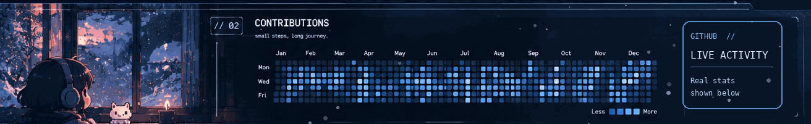
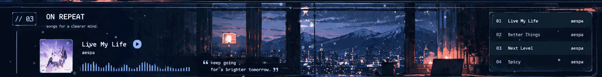
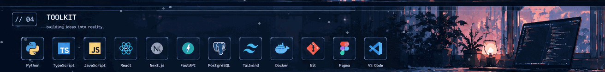
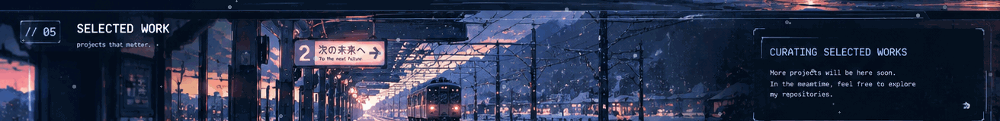
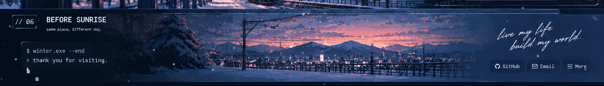

<!-- WINTER.EXE | Snow Station · GitHub-native animated README -->

<!-- Genuine activity: the reference illustration contained fictional example metrics,
     so real numbers are deliberately not baked into the picture. -->

<a href="https://github.com/alvinaug1105?tab=repositories">Explore my repositories</a> · <a href="https://www.youtube.com/watch?v=YEA1ROHi0Eg">aespa — Live My Life</a>

<b>WINTER.EXE / live contribution animation</b>

<!-- Appears after .github/workflows/snake.yml first runs successfully. -->

<b>About & accessibility</b>

**WINTER** · Developer / Creative Builder · Web, AI & simulation projects.  
**Soundtrack:** [aespa — Live My Life (official MV)](https://www.youtube.com/watch?v=YEA1ROHi0Eg)  
**Projects:** [Public GitHub repositories](https://github.com/alvinaug1105?tab=repositories)

The six winter scenes use looping GIF animation. The contribution mosaic inside the second scene is an **illustration**, not a factual activity chart; the live GitHub stats and generated contribution animation use real public data. The music graphic is illustrative, not an audio player.

