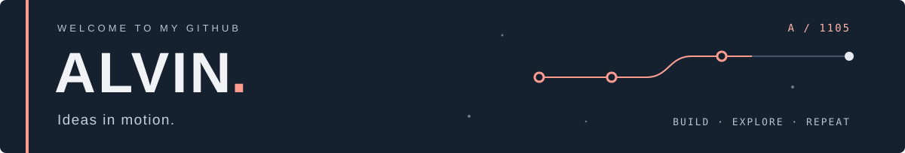
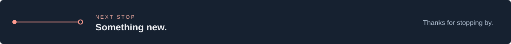

<!-- Profile README for alvinaug1105. Artwork supplied by the profile owner. -->

  
  <picture>
    <source media="(max-width: 600px)" srcset="./assets/nameplate-mobile.svg" />
    
  </picture>

  Experiments in machine learning, photo aesthetics, and Formula 1.

  <a href="https://github.com/alvinaug1105?tab=repositories">Explore my repositories</a>
  &nbsp; · &nbsp;
  <a href="https://github.com/alvinaug1105?tab=stars">Things I find interesting</a>

 

## Selected stops

### 01 &nbsp; / &nbsp; [Photo Aesthetic Scorer](https://github.com/alvinaug1105/photo-aesthetic-scorer) ↗

Exploring what makes a photo work with NIMA and computer vision.

Python &nbsp; / &nbsp; Streamlit &nbsp; / &nbsp; TensorFlow &nbsp; / &nbsp; OpenCV

---

### 02 &nbsp; / &nbsp; [F1 2026 Race Predictor](https://github.com/alvinaug1105/f1-2026-race-predictor) ↗

Formula 1 podium predictions through race data and machine learning.

Python &nbsp; / &nbsp; Streamlit &nbsp; / &nbsp; XGBoost &nbsp; / &nbsp; FastF1

---

### 03 &nbsp; / &nbsp; [Formula Operations](https://github.com/alvinaug1105/F1-sim-game) ↗

An early-stage racing management game, starting with data and simulation foundations.

Next.js &nbsp; / &nbsp; TypeScript &nbsp; / &nbsp; Prisma &nbsp; / &nbsp; PostgreSQL

 

  <picture>
    <source media="(max-width: 600px)" srcset="./assets/next-stop-mobile.svg" />
    
  </picture>

